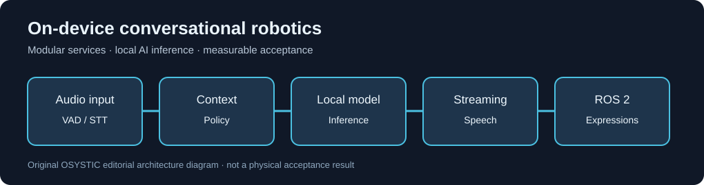

# Edge AI Companion Robotics - Engineering Case Study

**OSYSTIC ENGINEERING CASE STUDY | SANITIZED PUBLIC SHOWCASE | COMPLETE CASE STUDY**

No client identity, proprietary character canon, access details, private messages,
original code, recordings, machine addresses, or confidential evaluation logs.

## Executive summary

OSYSTIC developed and evaluated an on-device conversational robotics prototype
integrating speech recognition, local small-model inference, speech synthesis,
audio attention and ROS 2 services under embedded-computing constraints.

The work validated isolated components and staged integrations and identified
limits around personality consistency, hands-free interruptions and acceptance.

Original editorial diagram, not a customer screenshot.

## OSYSTIC PACE

**P - Problem and constraints:** build a responsive on-device conversational
stack without assuming unlimited GPU memory or reliance on hosted inference.

**A - Architecture and decisions:** split perception, transcription, local
inference, streaming speech, runtime diagnostics and ROS 2 expression intents.

**C - Contribution and delivery:** integration adapters, quality test suites,
voice processing experiments, hardware validation and runtime diagnostics.

**E - Evidence and outcomes:** staged integration tests succeeded, while
human-level dialogue consistency and fully hands-free conversational behavior
required additional acceptance work.

## Stack

Python | ROS 2 | NVIDIA Jetson / ARM | Local LLM | Whisper STT | Piper TTS |
Voice activity detection | Edge inference | Regression QA

## Outcome

**Engineering engagement closed; case study documentation complete.**
Some foundational functionality was delivered and documented. The fully
envisioned companion experience was not independently accepted as complete.

[Engineering narrative](case-study.md) |
[Architecture](docs/architecture.md) |
[Validation](docs/validation.md) |
[Lessons](docs/lessons-learned.md) |
[Privacy and disclosure](docs/disclosure-boundary.md)

OSYSTIC | https://www.osystic.com/
